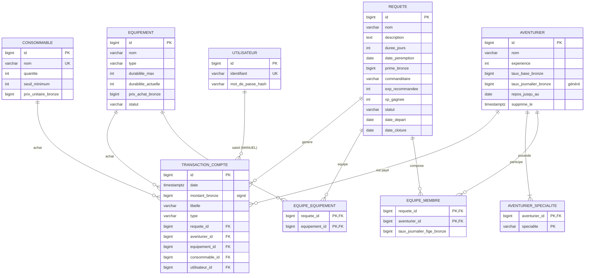

# Base de données

Schéma de la base PostgreSQL des Capuches d'Opale, dérivé du contrat d'API (`openapi.yaml`) et du product backlog.

Stack : **PostgreSQL** + **Spring Data JPA** + migrations **Flyway**.

## Pourquoi des migrations Flyway

Une migration est un fichier SQL qui décrit **une modification** de la base (créer une table, ajouter une colonne…). Flyway exécute ces fichiers dans l'ordre et note dans une table (`flyway_schema_history`) ceux qui ont déjà été appliqués.

- **Même base pour tout le monde** : à 5, chacun a sa base locale. Au démarrage du back, Flyway applique automatiquement les migrations manquantes. Personne n'a besoin d'exécuter un script à la main ni de demander « tu as ajouté quelle colonne ? ».
- **Historique versionné dans Git** : chaque changement de schéma passe par une PR, est relu et reste traçable, comme le code.
- **Pas de `ddl-auto` de Hibernate** : laisser Hibernate modifier la base tout seul (`spring.jpa.hibernate.ddl-auto=update`) est imprévisible (il ne supprime rien, gère mal les renommages et ignore les données existantes). Avec Flyway, on écrit exactement le SQL voulu et Hibernate se contente de vérifier (`ddl-auto=validate`).
- **Même chemin en dev, en CI et en production** : la CI part d'une base vide et rejoue toutes les migrations, ce qui prouve qu'elles fonctionnent avant la mise en production (TRV-04).
- **Intégré à Spring Boot** : il suffit d'ajouter les dépendances `flyway-core` et `flyway-database-postgresql`, puis de déposer les fichiers dans `back/src/main/resources/db/migration`.

## Diagramme



## Règles métier et liens entre les tables

### Requête

- Une requête est créée au statut `NOUVELLE`, puis suit le cycle `NOUVELLE → EQUIPE_VALIDEE → EN_COURS → REUSSIE | ECHOUEE`.
- Si sa `date_peremption` passe sans équipe validée, une tâche planifiée la passe en `REJETEE` (REQ-03).
- Elle n'est modifiable qu'en `NOUVELLE` ou `EQUIPE_VALIDEE`.
- Les montants (`prime_bronze`) sont des entiers en bronze (1 PO = 100 bronze) : aucune erreur d'arrondi.

### Aventurier ↔ spécialités (`aventurier_specialite`)

- Un aventurier a **au moins une** spécialité et peut en avoir plusieurs (le contrat expose `specialites[]`).
- Une colonne `specialite` dans `aventurier` ne pourrait en stocker qu'une seule. On utilise donc une table à part, avec une ligne par spécialité.
- Le taux journalier (`J_base × (1 + 0,5 × ln(Exp))`) est calculé par la base dans une colonne générée, pour pouvoir trier les aventuriers par taux (AVT-02).
- Un aventurier supprimé est seulement marqué (`supprime_le`) : ses anciens paiements doivent rester rattachés à lui.

### Requête ↔ aventuriers (`equipe_membre`)

- Une requête a **plusieurs** aventuriers, et un aventurier participe à **plusieurs** requêtes au fil du temps. C'est une relation plusieurs-à-plusieurs, d'où la table de liaison.
- Un aventurier ne peut être que dans **une seule équipe active** (requête `EQUIPE_VALIDEE` ou `EN_COURS`). Le service le vérifie à la validation.
- À la validation, on fige son taux journalier (`taux_journalier_fige_bronze`) : si son expérience augmente plus tard, le coût de cette mission ne change pas.
- Son statut affiché (`DISPONIBLE`, `EN_MISSION`, `EN_REPOS`) n'est pas stocké : il se déduit de sa présence dans une équipe active et de `repos_jusqu_au`.

### Requête ↔ équipements (`equipe_equipement`)

1. **Une requête utilise plusieurs équipements** (`equipementIds[]`).
2. **Un équipement sert à plusieurs requêtes au fil du temps** : une épée part en mission en janvier, revient, puis repart en mars. Avec `requete_id` dans `equipement`, la valeur serait écrasée à chaque nouvelle mission. On perdrait l'historique : on ne saurait plus quelle mission a usé cet équipement.
3. **Le brouillon d'équipe** : avant la validation, la composition change plusieurs fois. Avec une table de liaison, on ajoute ou on retire des lignes sans toucher à l'équipement lui-même.


Règles associées :
- À la validation de l'équipe, les équipements passent `EMPRUNTE` en même temps que les aventuriers sont réservés : **tout ou rien** (EQP-05).
- À la clôture, la durabilité baisse de la durée de la mission. À 0, l'équipement passe `EN_REPARATION` (INV-03).
- `durabilite_actuelle` reste toujours entre 0 et `durabilite_max`.

### Transactions (`transaction_compte`)

- Toute entrée ou sortie d'argent est une ligne de `transaction_compte`, avec un montant **signé** (positif = crédit, négatif = débit).
- Une transaction ne se modifie **jamais** : une correction est une nouvelle transaction. Le solde est la somme des montants.
- Une transaction est liée à d'autres tables selon son type :

| Type | Lié à | Quand |
|---|---|---|
| `ACOMPTE` | requête | Départ du groupe : 20 % de la prime (FIN-01) |
| `SOLDE` | requête | Clôture en succès : les 80 % restants (FIN-02) |
| `PAIEMENT_AVENTURIER` | requête + aventurier | Clôture : chaque membre est payé (taux figé × durée) |
| `ACHAT` | équipement ou consommable | Achat d'inventaire (INV-01, INV-02) |
| `MANUEL` | utilisateur | Ajout ou retrait à la main (CPT-01) |

- La base garantit **un seul** `ACOMPTE` et **un seul** `SOLDE` par requête (index unique) : un double clic sur « Départ » ou « Clôturer » ne crée pas deux paiements.
- La clôture (paiements, XP, repos, durabilité) se fait dans **une seule transaction SQL** : soit tout est enregistré, soit rien.

### Inventaire

- `equipement` : un objet unique, avec son statut (`DISPONIBLE`, `EMPRUNTE`, `EN_REPARATION`) et sa durabilité.
- `consommable` : un stock (quantité). Il est en « stock bas » quand `quantite < seuil_minimum`.

### Utilisateur

- Les assistants de la guilde qui se connectent (TRV-01). Le mot de passe est haché avec BCrypt, jamais stocké en clair.

## Nomenclature des migrations

Flyway trie les migrations par leur **version**. Avec une numérotation `V1`, `V2`, `V3`…, deux développeurs qui travaillent en même temps créent tous les deux un `V4` : conflit au merge, et chacun doit vérifier le dernier numéro avant de créer son fichier.

On utilise donc **la date et l'heure de création** comme version : deux personnes n'obtiennent pratiquement jamais la même.

### Format

```
V<AAAAMMJJ>_<HHMM>__<description>.sql
```

- `V` majuscule
- la date `AAAAMMJJ`, un `_`, puis l'heure `HHMM` (sur 24 h)
- **deux** underscores `__` avant la description
- une description en minuscules, sans accents, mots séparés par `_`, sous la forme verbe + objet

Flyway lit `V20261117_1430` comme la version `20261117.1430`.

### Exemples

```
back/src/main/resources/db/migration/
├── V20261118_0915__creer_table_utilisateur.sql
├── V20261118_1002__creer_table_requete.sql
├── V20261118_1040__creer_tables_aventurier.sql
├── V20261119_1415__creer_tables_inventaire.sql
├── V20261119_1630__creer_tables_equipe.sql
├── V20261120_1105__creer_table_transaction_compte.sql
└── V20261125_1420__ajouter_seuil_minimum_consommable.sql
```


### Règles d'équipe

1. **Ne jamais modifier une migration déjà mergée** sur `develop`. Flyway enregistre une somme de contrôle de chaque fichier et refuse de démarrer si un fichier a changé. Pour corriger, on crée une nouvelle migration.
2. **Une migration = un sujet** (une table, ou une modification cohérente), dans la même PR que le code qui l'utilise.
3. **Activer `out-of-order`** : si A crée sa migration à 10 h mais que B, avec une migration de 11 h, merge avant lui, la migration de A devient « plus ancienne » qu'une migration déjà appliquée. Sans cette option, Flyway la refuse.

   ```properties
   spring.flyway.out-of-order=true
   spring.jpa.hibernate.ddl-auto=validate
   ```

